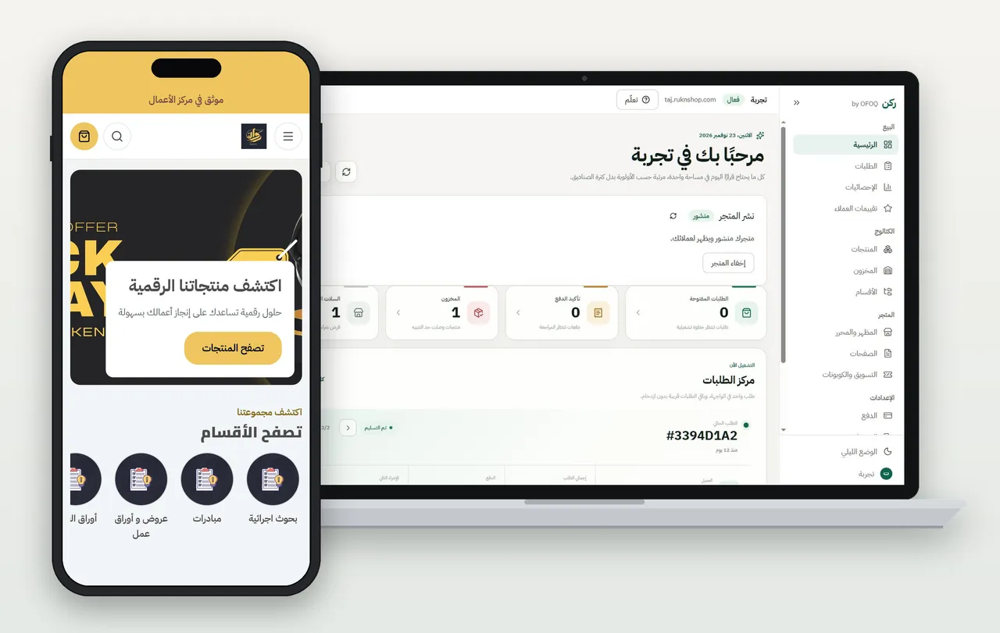
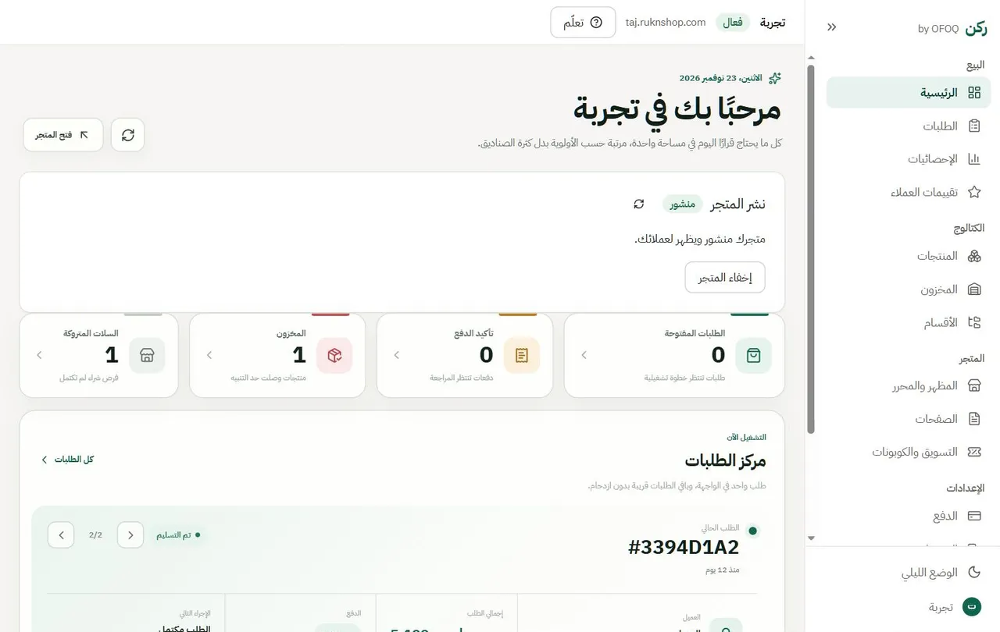
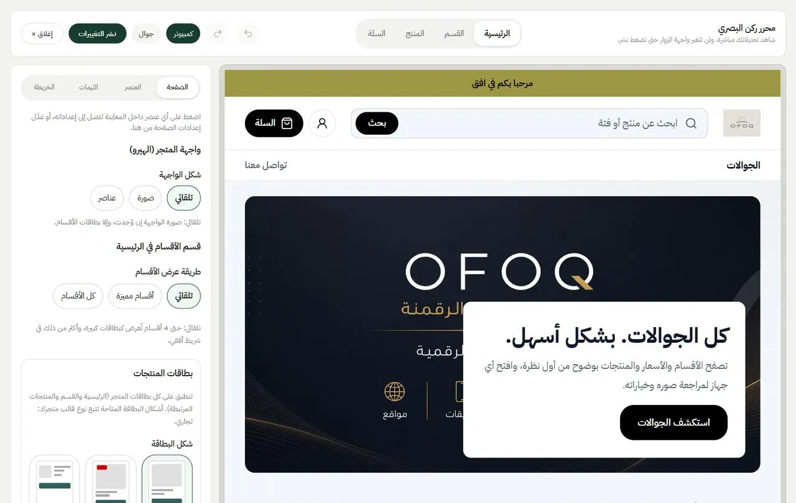
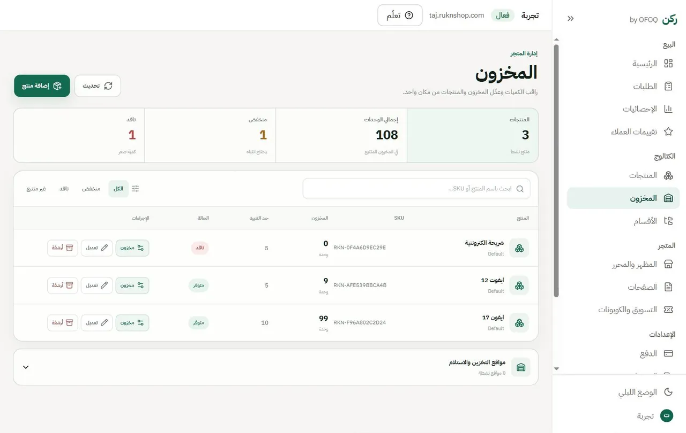
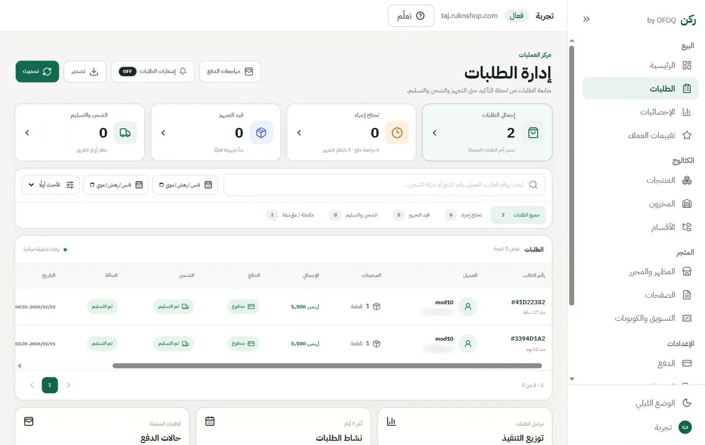
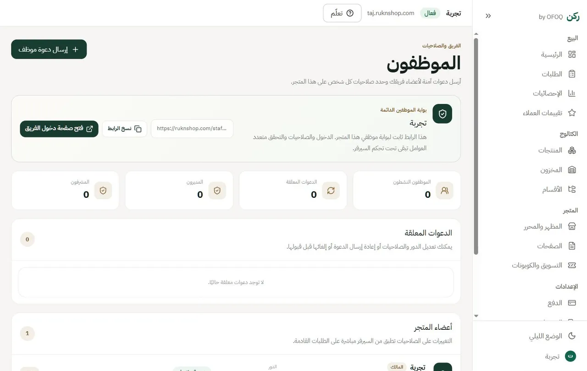

# RUKN · ركن

A SaaS platform for building and running online stores.

RUKN lets small and mid-sized businesses open an online store without hiring a developer. One platform serves every merchant, each with its own isolated data. The first market is Syria, with payments through Sham Cash and both delivery and pickup.

> This repo is a public write-up. The product source is private.
> Full case study: [mohammedkhankan.github.io/khankan-portfolio/en/projects/rukn](https://mohammedkhankan.github.io/khankan-portfolio/en/projects/rukn/)

## Where it stands

- Live. 10 stores in the first launch, including Rawan Office Services.
- 30-day free trial, then monthly or yearly plans.
- Development continues: launch readiness first, then more local payment and shipping options.

## What a merchant gets

Dashboard and publish status · products and categories · inventory across storage locations · orders by stage · abandoned carts · Sham Cash payments · delivery and pickup · visual store editor · brand and themes · analytics · staff permissions · subscription plans

## Engineering decisions

**One shared platform, not a copy per client.** A single codebase serves every merchant, so a fix or a security patch reaches everyone at once and running costs stay low.

**Tenant isolation in the data layer.** Store data is keyed to its tenant, and the rule is enforced in the data-access layer rather than relying on each screen to remember it.

**Transactions where money and stock meet.** Creating an order and reserving its stock run as one unit: both happen or neither does. When two orders reach for the last item at the same moment, only one gets it.

**Constraints in the database.** Relationships and order states are guarded by database constraints, so invalid combinations can't be stored even if application code has a bug.

**Two permission worlds.** Platform-admin permissions are separate from store-staff permissions, and every operation is authorized on the server.

**.NET and PostgreSQL for the core.** A strongly typed stack with solid transaction support, chosen because the product handles money and stock.

## Screens

Real screens from a demo merchant account. Private data is blurred.

| Dashboard | Store editor |
|---|---|
|  |  |

| Inventory | Orders |
|---|---|
|  |  |

## Stack

ASP.NET Core (.NET 10) · Entity Framework Core · PostgreSQL · React · TypeScript · Docker · Cloudflare (edge) · Bunny (media storage and delivery)

---

Built by [Mohammed Khankan](https://github.com/mohammedkhankan) · OFOQ Technical Solutions & Digitalization. For a demo: engmohammedkhankan@gmail.com
